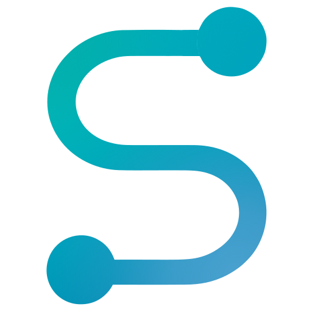
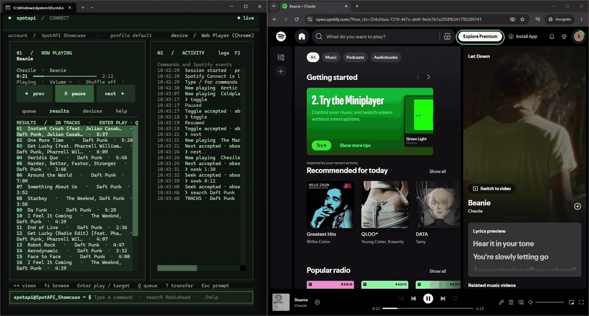
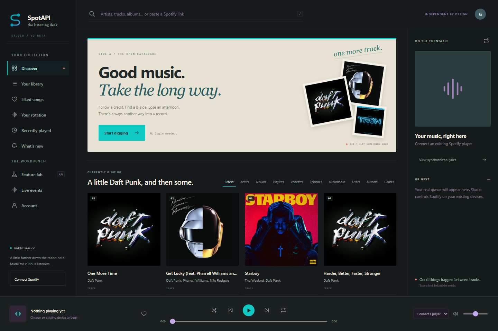

<p align="center">
  
</p>

<h1 align="center">SpotAPI</h1>

<p align="center">
  <strong>Crea aplicaciones de Spotify en Python con una API tipada y asíncrona.</strong>
</p>

<p align="center">
  Usa SpotAPI para el catálogo público, las listas y los reproductores conectados de Spotify.<br>
  <strong>Sin aplicación de desarrollador ni clave API para datos públicos.</strong>
</p>

<p align="center">
  <a href="#comienza-ahora">Comienza ahora</a> ·
  <a href="#explora-desde-la-terminal">Explora</a> ·
  <a href="#desarrolla-con-python">API de Python</a> ·
  <a href="https://spotapi.readthedocs.io/">Documentación</a> ·
  <a href="SPONSORSHIP.md">Patrocinar</a>
</p>

<p align="center">
  <a href="https://discord.gg/vcFvvTuQzn"></a>
</p>

<p align="center">
  <strong>Idioma:</strong> <a href="README.md">English</a> · <a href="README.pt-BR.md">Português (Brasil)</a> · Español · <a href="README.fr.md">Français</a> · <a href="README.ja.md">日本語</a>
</p>

## Comienza ahora

Se requiere Python 3.11 o posterior. Comienza con una búsqueda real, sin iniciar sesión en Spotify, Client ID ni configuración.

```bash
python -m pip install spotapi
python -m spotapi search "Daft Punk"
```

Usa la misma API en Python:

```python
import asyncio
from spotapi import Public

async def main():
    results = await Public.search("Daft Punk", limit=5)
    for track in results.tracks:
        print(track.name, track.uri)

asyncio.run(main())
```

[Más ejemplos en Python](#desarrolla-con-python) · [Auditoría de listas y exportación CSV](examples/playlist_audit.py) · [Guía de Python sin clave API](docs/no-api-key.md)

La primera solicitud puede tardar más mientras SpotAPI descubre y almacena en caché las consultas actuales del reproductor web.

Prueba el explorador interactivo de terminal:

```bash
python -m pip install "spotapi[demo]"
python -m spotapi discover "Daft Punk"
```

Explora resultados de búsqueda, carátulas y enlaces de Spotify sin iniciar sesión. [Ejemplo de Discover](https://github.com/Aran404/SpotAPI/blob/main/examples/discover.py) · [Solución de problemas](https://spotapi.readthedocs.io/en/latest/troubleshooting/)

## Explora desde la terminal

La CLI va más allá de la búsqueda. Consulta un artista, obtén los créditos de una canción o enumera una lista de reproducción pública:

```bash
python -m spotapi search "Daft Punk" --type artist --json
python -m spotapi get SPOTIFY_URL
python -m spotapi playlist items PLAYLIST_ID --limit 10
```

Estos comandos funcionan sin clave API de desarrollador. Las operaciones de cuenta — canciones guardadas, listas privadas y control de tu reproductor de Spotify existente — requieren tu propia sesión de Spotify. Consulta la [guía de cuenta](https://spotapi.readthedocs.io/en/latest/account/) y la [guía del reproductor](https://spotapi.readthedocs.io/en/latest/player/).

### Connect: controla tu reproductor de Spotify

Connect reúne búsqueda, selección de dispositivo, cola de próximas canciones, reproducción y un registro de actividad en directo en una sesión de terminal diseñada para el teclado. Controla un reproductor de Spotify existente con sesión iniciada; **no** transmite, descarga ni descifra canciones.



<p align="center"><sub>Connect · Busca, navega y controla un reproductor de Spotify existente desde tu terminal. Spotify reproduce el audio; SpotAPI envía los controles.</sub></p>

Inicia Connect:

```bash
python -m pip install "spotapi[connect,browser]"
python -m playwright install chromium
python -m spotapi connect
```

Estos comandos permiten iniciar sesión por primera vez desde el navegador. ¿Ya usas `SPOTIFY_COOKIE` o tienes un perfil guardado en Connect? Instala solo `spotapi[connect]` y omite la descarga del navegador.

Usa `search Daft Punk`, `queue 1`, `pause`, `next` o `seek 1:30`. `Ctrl+P` abre la paleta de comandos. Consulta la [guía de Connect](docs/connect.md) para seleccionar dispositivos y configurar.

## Descubre qué más puede hacer

SpotAPI también impulsa **Studio**, un explorador musical de escritorio construido con la misma biblioteca. Abre canciones, consulta créditos, sigue artistas y álbumes y muestra letras sincronizadas. Con un reproductor de Spotify conectado, hacer clic en una línea de la letra puede desplazar la reproducción a ese momento.



[Mira la demostración de letras sincronizadas (GIF, unos 11 MB)](assets/lyrics-sync-demo.gif) · Studio no transmite canciones completas de Spotify.

```bash
python -m pip install "spotapi[studio]"
python -m spotapi studio
```

Studio utiliza una WebView nativa. La [configuración de Studio](https://spotapi.readthedocs.io/en/latest/studio/) explica los requisitos de la plataforma y cómo iniciar sesión en Spotify. La disponibilidad de las letras depende de la fuente y los permisos de la cuenta; saltar a un momento requiere un reproductor autenticado que admita el control.

## Apoya a SpotAPI

Los patrocinadores ayudan a mantener SpotAPI gratuito y financian el mantenimiento, las pruebas y la documentación. [Conviértete en patrocinador](SPONSORSHIP.md).

<details open>
<summary><strong>Patrocinadores</strong></summary>

<!-- Each sponsor gets a separate table. Add new cards before the closing details tag. -->

<table>
  <tr>
    <td width="100%">
      <p align="center"><a href="https://www.rapidproxy.io/?code=Z89BQULDV"></a></p>
      <p>Proxies residenciales fiables para automatización con Python y recopilación de datos web. Más de 90 millones de IP, segmentación global, sesiones rotativas y persistentes y compatibilidad con HTTP(S)/SOCKS5.</p>
      <sub>Patrocinio pagado · Enlace de afiliado. SpotAPI puede recibir una comisión por las compras.</sub>
    </td>
  </tr>
</table>

</details>

## Desarrolla con Python

Reutiliza una sesión del catálogo para operaciones relacionadas:

```python
import asyncio
from spotapi import Catalogue


async def main() -> None:
    async with Catalogue() as spotify:
        results = await spotify.search("Daft Punk")
        if results.artists:
            artist = await spotify.get_artist(results.artists[0].uri)
            print(artist.name)


asyncio.run(main())
```

**¿Trabajas con listas grandes?** [Audita hasta 10.000 entradas de una lista](examples/playlist_audit.py), identifica canciones duplicadas y entradas no disponibles, y exporta un CSV. El ejemplo pagina los resultados en lugar de cargar toda la lista en memoria. Ejecútalo desde una copia local del repositorio.

### Próximos pasos

| Qué desarrollar | Empieza aquí |
|---|---|
| Herramientas de búsqueda musical o metadatos públicos | [Catálogo público](https://spotapi.readthedocs.io/en/latest/catalogue/) |
| Organizador de listas que gestiona correctamente las canciones duplicadas | [API de listas](https://spotapi.readthedocs.io/en/latest/account/) |
| Pantalla o controlador en directo de la canción actual | [Ejemplo de reproductor](https://github.com/Aran404/SpotAPI/blob/main/examples/player.py) |
| Panel personal de música | [Cuenta y estadísticas](https://spotapi.readthedocs.io/en/latest/account/) |
| Colección para DJ basada en tempo y tonalidades armónicas | [Colección de lista](https://github.com/Aran404/SpotAPI/blob/main/examples/playlist_crate.py) |
| Recomendador local y experimental de música | [Taste Lab](https://github.com/Aran404/SpotAPI/blob/main/examples/taste_lab/README.md) |

## ¿Por qué SpotAPI?

- **Empieza sin credenciales.** La búsqueda y los metadatos del catálogo público no requieren una aplicación de desarrollador de Spotify.
- **Resultados tipados y asíncronos.** Trabaja con modelos de Python en lugar de adivinar claves de diccionario.
- **E/S explícita.** Leer un modelo no desencadena silenciosamente otra solicitud HTTP.
- **Más que metadatos de solo lectura.** Con tu sesión autenticada, administra música guardada, edita entradas de listas y controla reproductores existentes.
- **Diseñado para explorar.** Usa la CLI, Discover y Studio para conocer sus funciones antes de integrarlas en tu código.

SpotAPI utiliza endpoints no oficiales del reproductor web de Spotify, por lo que su comportamiento puede cambiar cuando Spotify los modifica. **No** sustituye a la Web API oficial en todos los casos, y el acceso a datos públicos es distinto del acceso autenticado a la reproducción. [Compara las API](https://spotapi.readthedocs.io/en/latest/from-spotipy/) · [Límites de verificación](https://spotapi.readthedocs.io/en/latest/release-checks/#boundaries)

## Documentación y migración

[Inicio rápido](https://spotapi.readthedocs.io/en/latest/quickstart/) · [Referencia de la API](https://spotapi.readthedocs.io/en/latest/reference/) · [Migración desde Spotipy](https://spotapi.readthedocs.io/en/latest/from-spotipy/) · [CLI y exploración](https://spotapi.readthedocs.io/en/latest/discovery/) · [Solución de problemas](https://spotapi.readthedocs.io/en/latest/troubleshooting/)

**¿Actualizas desde la v1?** SpotAPI 2 prioriza las operaciones asíncronas e incluye cambios incompatibles. Las aplicaciones existentes de la v1 pueden fijar `spotapi==1.2.8` mientras migran, o usar `SyncCatalogue` en nuevos scripts síncronos. Lee la [guía de migración](MIGRATION.md).

## Cómo contribuir

Se agradecen los informes de errores, los problemas reproducibles y las contribuciones bien pensadas. [Contribuir](CONTRIBUTING.md) · [Pruebas](tests/README.md) · [Aviso legal](LEGAL_NOTICE.md) · [GPL-3.0](LICENSE)

Si SpotAPI te ayuda a crear algo, **[dale una estrella al repositorio](https://github.com/Aran404/SpotAPI)** para que más desarrolladores lo descubran.
