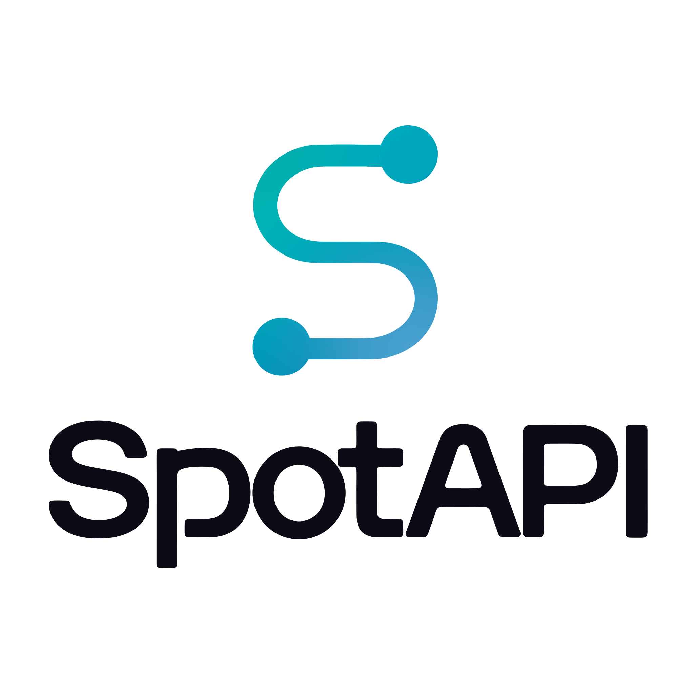
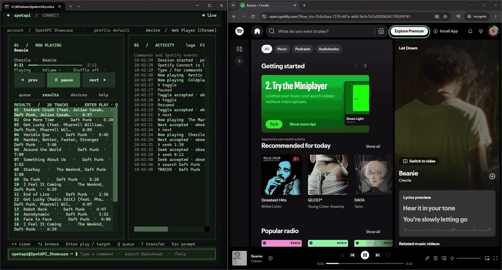
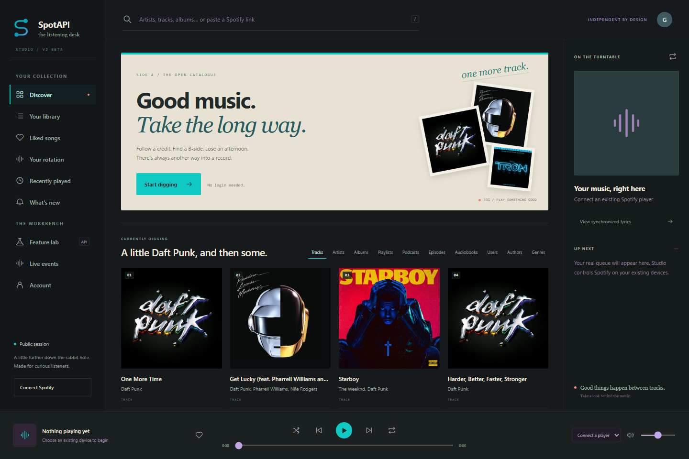

<p align="center">
  
</p>

<h1 align="center">SpotAPI</h1>

<p align="center">
  <strong>Spotify dans votre terminal. Les données Spotify dans vos applications Python.</strong>
</p>

<p align="center">
  Une bibliothèque Python typée et asynchrone pour le catalogue public, les playlists et les lecteurs connectés de Spotify.<br>
  <strong>Aucune application développeur ni clé API requise pour les données publiques.</strong>
</p>

<p align="center">
  <a href="#bien-démarrer">Bien démarrer</a> ·
  <a href="#explorer-dans-le-terminal">Explorer</a> ·
  <a href="#développer-avec-python">API Python</a> ·
  <a href="https://spotapi.readthedocs.io/">Documentation</a> ·
  <a href="SPONSORSHIP.md">Parrainer</a>
</p>

<p align="center">
  <strong>Langue :</strong> <a href="README.md">English</a> · <a href="README.pt-BR.md">Português (Brasil)</a> · <a href="README.es.md">Español</a> · Français · <a href="README.ja.md">日本語</a>
</p>

## Bien démarrer

Python 3.11 ou une version ultérieure est nécessaire. Commencez par une vraie recherche, sans connexion Spotify, identifiant client ni configuration.

```bash
python -m pip install spotapi
python -m spotapi search "Daft Punk"
```



<p align="center"><sub>Connect · Recherchez, naviguez et pilotez un lecteur Spotify existant depuis votre terminal. Spotify lit l'audio ; SpotAPI envoie les commandes.</sub></p>

Vous accédez ainsi au catalogue public. Recherchez des titres, résolvez des liens Spotify, consultez les crédits et lisez les métadonnées de playlists publiques sans créer d'application développeur Spotify. La première requête peut être plus longue, car SpotAPI découvre les requêtes actuelles du lecteur Web ; les suivantes réutilisent les résultats mis en cache.

**Vous préférez développer en Python ?** La même installation fournit une API typée. Aucune interface de terminal n'est nécessaire :

```python
import asyncio
from spotapi import Public

async def main():
    results = await Public.search("Daft Punk", limit=5)
    for track in results.tracks:
        print(track.name, track.uri)

asyncio.run(main())
```

[Autres exemples Python](#développer-avec-python) · [Audit de playlists et export CSV](examples/playlist_audit.py)

**Vous préférez une interface de navigation ?** Ouvrez l'explorateur interactif dans le terminal :

```bash
python -m pip install "spotapi[demo]"
python -m spotapi discover "Daft Punk"
```

Parcourez les résultats de recherche, les pochettes et les liens Spotify sans vous connecter. [Exemple Discover](https://github.com/Aran404/SpotAPI/blob/main/examples/discover.py) · [Dépannage](https://spotapi.readthedocs.io/en/latest/troubleshooting/)

## Explorer dans le terminal

L'interface en ligne de commande ne se limite pas à la recherche. Examinez un artiste, récupérez les crédits d'un morceau ou listez le contenu d'une playlist publique :

```bash
python -m spotapi search "Daft Punk" --type artist --json
python -m spotapi get SPOTIFY_URL
python -m spotapi playlist items PLAYLIST_ID --limit 10
```

Ces commandes fonctionnent sans clé API développeur. Les opérations liées à votre compte — titres aimés, playlists privées et pilotage de votre lecteur Spotify existant — nécessitent votre propre session Spotify. Consultez le [guide du compte](https://spotapi.readthedocs.io/en/latest/account/) et le [guide du lecteur](https://spotapi.readthedocs.io/en/latest/player/).

### Connect : pilotez votre lecteur Spotify

Connect rassemble la recherche, la sélection d'appareil, la file d'attente, la lecture et un journal d'activité en direct dans une interface de terminal pensée pour le clavier. Il commande un lecteur Spotify existant sur lequel vous êtes connecté ; il ne **diffuse, télécharge ni déchiffre** les morceaux.

Lancez Connect avec l'interface de terminal facultative :

```bash
python -m pip install "spotapi[connect,browser]"
python -m playwright install chromium
python -m spotapi connect
```

Ces commandes permettent une première connexion via le navigateur. Vous utilisez déjà `SPOTIFY_COOKIE` ou un profil Connect enregistré ? Installez uniquement `spotapi[connect]` et évitez le téléchargement du navigateur.

Utilisez `search Daft Punk` pour trouver de la musique, `queue 1` pour ajouter un résultat à la file d'attente, ou `pause`, `next` et `seek 1:30` pour contrôler la lecture. Ouvrez `/devices` pour voir les lecteurs disponibles ; `/use 2` en sélectionne un sans transférer la lecture, tandis que `/transfer 2` effectue le transfert. `Ctrl+P` ouvre la palette de commandes.

Connect nécessite votre session Spotify pour piloter la lecture. Pour vous connecter via un navigateur, l'extra `browser` et l'installation de Chromium avec Playwright peuvent aussi être nécessaires ; consultez le [guide Connect](docs/connect.md) pour la configuration.

## Découvrez ses autres possibilités

SpotAPI fait également fonctionner **Studio**, un explorateur musical de bureau construit avec la même bibliothèque. Ouvrez des titres, consultez les crédits, suivez des artistes et des albums, et affichez des paroles synchronisées. Avec un lecteur Spotify connecté, cliquer sur une ligne de paroles peut déplacer la lecture à cet instant.



[Voir la démonstration des paroles synchronisées (GIF, environ 11 Mo)](assets/lyrics-sync-demo.gif) · Studio lui-même ne diffuse pas de morceaux Spotify complets.

```bash
python -m pip install "spotapi[studio]"
python -m spotapi studio
```

Studio utilise une WebView native. La [configuration de Studio](https://spotapi.readthedocs.io/en/latest/studio/) décrit les prérequis de chaque plateforme et la connexion à Spotify. La disponibilité des paroles dépend de leur source et des droits du compte ; se déplacer dans un morceau nécessite un lecteur authentifié et contrôlable.

## Développer avec Python

Les démonstrations en terminal sont des exemples. **SpotAPI est avant tout une bibliothèque Python :** opérations asynchrones, résultats typés, appels réseau explicites et sessions réutilisables.

```python
import asyncio
from spotapi import Public


async def main() -> None:
    results = await Public.search("Daft Punk", limit=5)
    for track in results.tracks:
        print(track.name, track.uri)


asyncio.run(main())
```

Pour plusieurs opérations liées, réutilisez une seule session de catalogue :

```python
import asyncio
from spotapi import Catalogue


async def main() -> None:
    async with Catalogue() as spotify:
        results = await spotify.search("Daft Punk")
        if results.artists:
            artist = await spotify.get_artist(results.artists[0].uri)
            print(artist.name)


asyncio.run(main())
```

**Vous travaillez avec de grandes playlists ?** [Auditez jusqu'à 10 000 occurrences d'une playlist](examples/playlist_audit.py), repérez les titres en double et les entrées indisponibles, puis exportez un fichier CSV. L'exemple parcourt les résultats page par page au lieu de charger toute la playlist en mémoire. Exécutez-le depuis une copie locale du dépôt.

### Pour aller plus loin

| Votre projet | Par où commencer |
|---|---|
| Outils de recherche musicale ou de métadonnées publiques | [Catalogue public](https://spotapi.readthedocs.io/en/latest/catalogue/) |
| Organisateur de playlists gérant correctement les doublons | [API Playlists](https://spotapi.readthedocs.io/en/latest/account/) |
| Affichage du morceau en cours ou télécommande en direct | [Exemple de lecteur](https://github.com/Aran404/SpotAPI/blob/main/examples/player.py) |
| Tableau de bord musical personnel | [Compte et statistiques](https://spotapi.readthedocs.io/en/latest/account/) |
| Sélection DJ basée sur le tempo et les tonalités harmoniques | [Sélection de playlist](https://github.com/Aran404/SpotAPI/blob/main/examples/playlist_crate.py) |
| Moteur expérimental local de recommandations musicales | [Taste Lab](https://github.com/Aran404/SpotAPI/blob/main/examples/taste_lab/README.md) |

## Pourquoi SpotAPI ?

- **Démarrez sans identifiants.** La recherche et les métadonnées du catalogue public ne nécessitent pas d'application développeur Spotify.
- **Résultats typés et asynchrones.** Utilisez des modèles Python plutôt que de deviner les clés de dictionnaires.
- **Entrées-sorties explicites.** Lire un modèle ne déclenche pas de requête HTTP supplémentaire à votre insu.
- **Au-delà des métadonnées en lecture seule.** Avec votre session authentifiée, gérez les titres enregistrés, modifiez les occurrences dans les playlists et contrôlez les lecteurs existants.
- **Conçu pour l'exploration.** Utilisez la CLI, Discover et Studio pour découvrir les fonctionnalités avant de les intégrer à votre code.

SpotAPI utilise des points de terminaison non officiels du lecteur Web de Spotify ; son comportement peut donc changer si Spotify les modifie. Il ne remplace **pas** l'API Web officielle pour tous les usages, et l'accès aux données publiques diffère de l'accès authentifié aux fonctions de lecture. [Comparer les API](https://spotapi.readthedocs.io/en/latest/from-spotipy/) · [Limites des vérifications](https://spotapi.readthedocs.io/en/latest/release-checks/#boundaries)

## Documentation et migration

[Démarrage rapide](https://spotapi.readthedocs.io/en/latest/quickstart/) · [Référence de l'API](https://spotapi.readthedocs.io/en/latest/reference/) · [Migration depuis Spotipy](https://spotapi.readthedocs.io/en/latest/from-spotipy/) · [CLI et découverte](https://spotapi.readthedocs.io/en/latest/discovery/) · [Dépannage](https://spotapi.readthedocs.io/en/latest/troubleshooting/)

**Vous venez de la v1 ?** SpotAPI 2 privilégie l'asynchrone et comporte des changements incompatibles. Les applications v1 existantes peuvent fixer la version `spotapi==1.2.8` pendant la migration, ou utiliser `SyncCatalogue` pour de nouveaux scripts synchrones. Lisez le [guide de migration](MIGRATION.md).

## Soutenir SpotAPI

SpotAPI est gratuit et open source. Le parrainage finance la maintenance, les tests et la documentation sans modifier le fonctionnement de la bibliothèque ni ajouter de fonctionnalités payantes.

**Vous créez des outils pour les développeurs ?** [Découvrez les possibilités de parrainage](SPONSORSHIP.md) dès 50 USD pour 30 jours. Les emplacements payants sont clairement signalés et placés après les démonstrations du produit.

<!-- Placez les parrainages actifs, clairement identifiés, sous cette ligne. Restez concis et positionnez-les après les démonstrations du produit. -->

## Contribuer

Les signalements de bogues, les problèmes reproductibles et les contributions réfléchies sont les bienvenus. [Contribuer](CONTRIBUTING.md) · [Tests](tests/README.md) · [Mentions légales](LEGAL_NOTICE.md) · [GPL-3.0](LICENSE)

Si SpotAPI vous aide à développer quelque chose, **[attribuez une étoile au dépôt](https://github.com/Aran404/SpotAPI)** pour aider d'autres développeurs à le découvrir.
