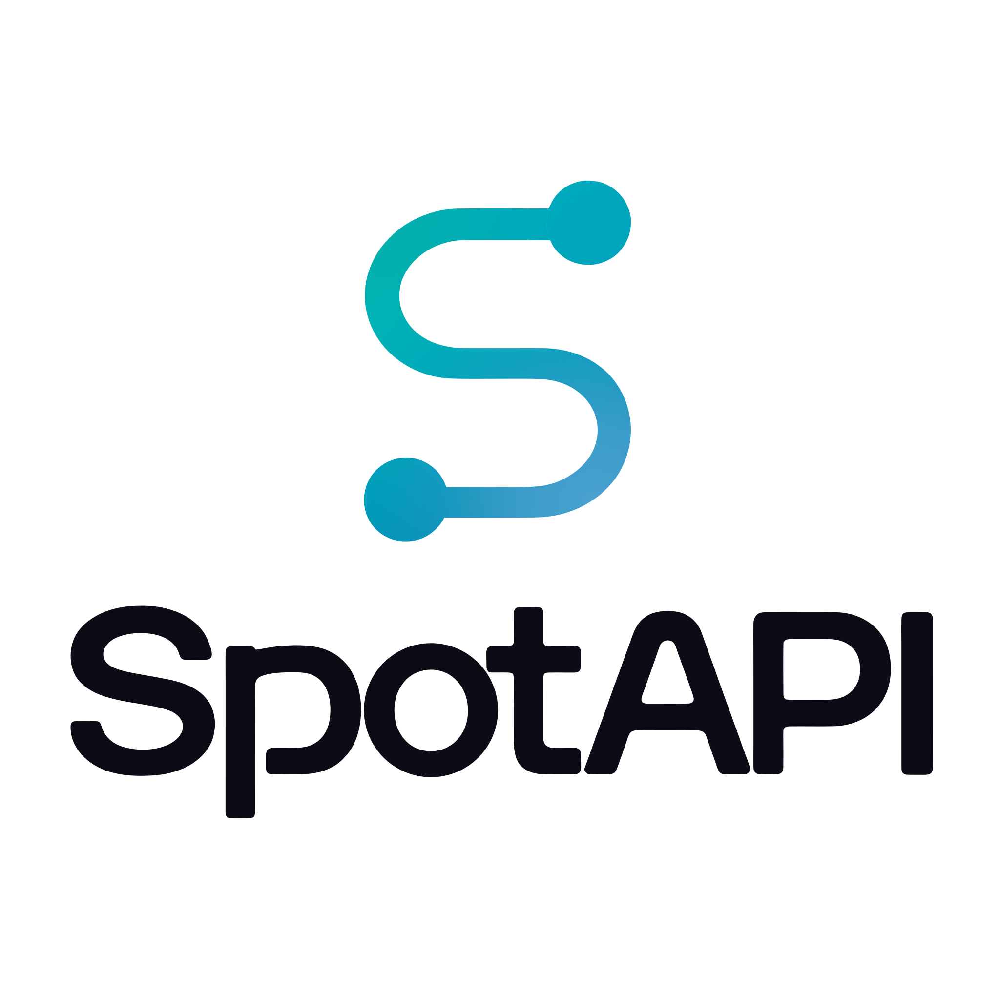
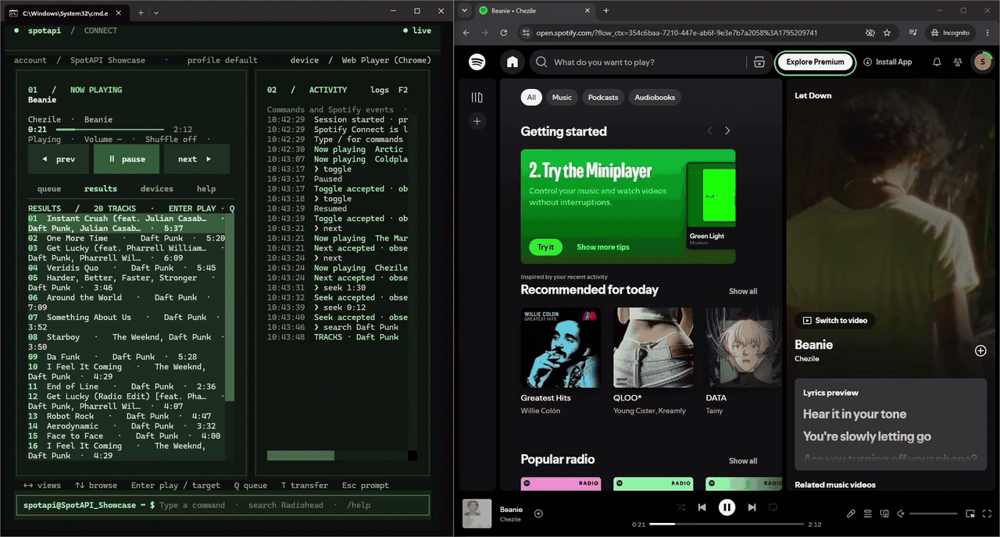
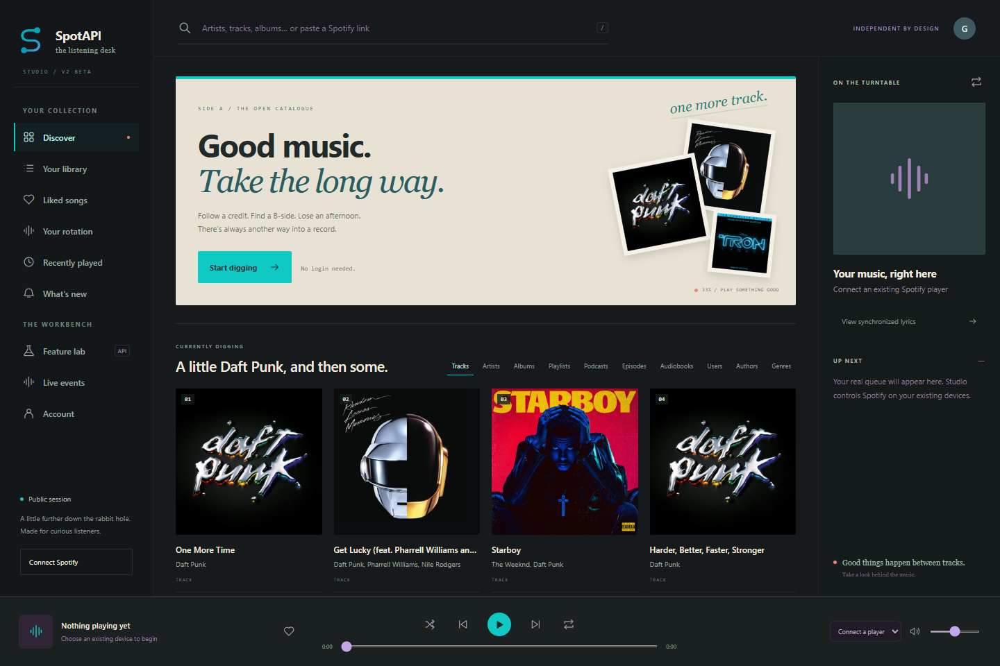

<p align="center">
  
</p>

<h1 align="center">SpotAPI</h1>

<p align="center">
  <strong>ターミナルで Spotify を。Python アプリで Spotify のデータを。</strong>
</p>

<p align="center">
  Spotify の公開カタログ、プレイリスト、接続されたプレーヤーを扱う、型付きの非同期 Python ライブラリです。<br>
  <strong>公開データの利用に開発者アプリや API キーは不要です。</strong>
</p>

<p align="center">
  <a href="#はじめに">はじめに</a> ·
  <a href="#ターミナルで探索する">探索</a> ·
  <a href="#python-で開発する">Python API</a> ·
  <a href="https://spotapi.readthedocs.io/">ドキュメント</a> ·
  <a href="SPONSORSHIP.md">スポンサー</a>
</p>

<p align="center">
  <strong>言語:</strong> <a href="README.md">English</a> · <a href="README.pt-BR.md">Português (Brasil)</a> · <a href="README.es.md">Español</a> · <a href="README.fr.md">Français</a> · 日本語
</p>

## はじめに

Python 3.11 以上が必要です。まずは実際に検索してみましょう。Spotify へのログイン、Client ID、設定は一切不要です。

```bash
python -m pip install spotapi
python -m spotapi search "Daft Punk"
```



<p align="center"><sub>Connect · ターミナルから既存の Spotify プレーヤーで検索、ナビゲート、操作ができます。音声を再生するのは Spotify で、SpotAPI は操作コマンドを送信します。</sub></p>

これが公開カタログです。Spotify 開発者アプリケーションを用意しなくても、検索、Spotify リンクの解決、クレジットの確認、公開プレイリストのメタデータの読み取りができます。最初のリクエストは SpotAPI が現在の Web プレーヤーのクエリを検出するため時間がかかることがありますが、以降のリクエストではキャッシュされた結果が再利用されます。

**Python で開発したいですか？** 同じインストールで型付き API が使えます。ターミナルインターフェースは不要です:

```python
import asyncio
from spotapi import Public

async def main():
    results = await Public.search("Daft Punk", limit=5)
    for track in results.tracks:
        print(track.name, track.uri)

asyncio.run(main())
```

[その他の Python の例](#python-で開発する) · [プレイリストの監査と CSV エクスポート](examples/playlist_audit.py)

**ブラウズできるものが欲しいですか？** インタラクティブなターミナルエクスプローラーを開きましょう:

```bash
python -m pip install "spotapi[demo]"
python -m spotapi discover "Daft Punk"
```

サインインせずに、検索結果、アートワーク、Spotify リンクをナビゲートできます。[Discover の例](https://github.com/Aran404/SpotAPI/blob/main/examples/discover.py) · [トラブルシューティング](https://spotapi.readthedocs.io/en/latest/troubleshooting/)

## ターミナルで探索する

CLI は検索だけではありません。アーティストの確認、トラックのクレジットの取得、公開プレイリストの一覧表示ができます:

```bash
python -m spotapi search "Daft Punk" --type artist --json
python -m spotapi get SPOTIFY_URL
python -m spotapi playlist items PLAYLIST_ID --limit 10
```

これらは開発者 API キーなしで動作します。アカウント操作 (お気に入りの曲、非公開プレイリスト、既存の Spotify プレーヤーの操作) には、ご自身の Spotify セッションが必要です。[アカウントガイド](https://spotapi.readthedocs.io/en/latest/account/)と[プレーヤーガイド](https://spotapi.readthedocs.io/en/latest/player/)を参照してください。

### Connect: Spotify プレーヤーを操作する

Connect は、検索、デバイス選択、次に再生する曲、再生操作、ライブアクティビティログを、キーボード操作しやすい 1 つのターミナルセッションにまとめます。サインイン済みの既存の Spotify プレーヤーを操作するもので、トラックのストリーミング、ダウンロード、復号は**行いません**。

オプションのターミナルインターフェースで Connect を起動します:

```bash
python -m pip install "spotapi[connect,browser]"
python -m playwright install chromium
python -m spotapi connect
```

これらのコマンドで初回のブラウザサインインを準備できます。すでに `SPOTIFY_COOKIE` または保存済みの Connect プロファイルがある場合は、`spotapi[connect]` のみをインストールし、ブラウザのダウンロードを省略できます。

`search Daft Punk` で音楽を検索し、`queue 1` で結果をキューに追加し、`pause`、`next`、`seek 1:30` で再生を操作します。`/devices` を開くと利用可能なプレーヤーを一覧できます。`/use 2` は再生を移さずにプレーヤーを選択し、`/transfer 2` は再生を移します。`Ctrl+P` でコマンドパレットが開きます。

Connect でプレーヤーを操作するには Spotify セッションが必要です。ブラウザでサインインする場合は、`browser` extra と Playwright の Chromium のインストールも必要になることがあります。セットアップについては [Connect ガイド](docs/connect.md)を参照してください。

## その他の機能を見る

SpotAPI は、同じライブラリで構築されたデスクトップ音楽エクスプローラー **Studio** も支えています。トラックを開き、クレジットを確認し、アーティストやアルバムをフォローし、タイミング付きの歌詞を表示できます。接続された Spotify プレーヤーがあれば、歌詞をクリックしてその行まで再生位置をシークできます。



[歌詞同期のデモを見る (GIF、約 11 MB)](assets/lyrics-sync-demo.gif) · Studio 自体は Spotify のトラック全体をストリーミングしません。

```bash
python -m pip install "spotapi[studio]"
python -m spotapi studio
```

Studio はネイティブの WebView を使用します。プラットフォームの要件と Spotify へのサインインについては [Studio のセットアップ](https://spotapi.readthedocs.io/en/latest/studio/)で説明しています。歌詞を利用できるかどうかはソースとアカウントの権利によって異なります。シークには認証済みで操作可能なプレーヤーが必要です。

## Python で開発する

ターミナルのデモはあくまで例です。**SpotAPI は何よりもまず Python ライブラリです:** 非同期の操作、型付きの結果、明示的なネットワーク呼び出し、再利用可能なセッションを備えています。

```python
import asyncio
from spotapi import Public


async def main() -> None:
    results = await Public.search("Daft Punk", limit=5)
    for track in results.tracks:
        print(track.name, track.uri)


asyncio.run(main())
```

関連する複数の操作を行う場合は、1 つのカタログセッションを再利用します:

```python
import asyncio
from spotapi import Catalogue


async def main() -> None:
    async with Catalogue() as spotify:
        results = await spotify.search("Daft Punk")
        if results.artists:
            artist = await spotify.get_artist(results.artists[0].uri)
            print(artist.name)


asyncio.run(main())
```

**大規模なプレイリストを扱っていますか？** [最大 10,000 件のプレイリスト内の項目を監査し](examples/playlist_audit.py)、重複したトラックや利用できない項目を特定して CSV にエクスポートできます。この例はプレイリスト全体をメモリに読み込まず、結果をページ単位で処理します。リポジトリをチェックアウトした環境で実行してください。

### 次のステップ

| 作りたいもの | まずはここから |
|---|---|
| 音楽検索や公開メタデータのツール | [公開カタログ](https://spotapi.readthedocs.io/en/latest/catalogue/) |
| 重複トラックを正しく扱うプレイリスト整理ツール | [Playlist API](https://spotapi.readthedocs.io/en/latest/account/) |
| 再生中の曲のライブ表示やコントローラー | [プレーヤーの例](https://github.com/Aran404/SpotAPI/blob/main/examples/player.py) |
| 個人用の音楽ダッシュボード | [アカウントと統計](https://spotapi.readthedocs.io/en/latest/account/) |
| テンポとハーモニックキーを使った DJ クレート | [Playlist crate](https://github.com/Aran404/SpotAPI/blob/main/examples/playlist_crate.py) |
| 実験的なローカル音楽レコメンダー | [Taste Lab](https://github.com/Aran404/SpotAPI/blob/main/examples/taste_lab/README.md) |

## SpotAPI を選ぶ理由

- **認証情報なしで始められます。** 公開カタログの検索とメタデータの取得に Spotify 開発者アプリは不要です。
- **型付きの非同期の結果。** 辞書のキーを推測する代わりに Python のモデルを扱えます。
- **明示的な I/O。** モデルを読み取っても、別の HTTP リクエストが暗黙に発生することはありません。
- **読み取り専用のメタデータにとどまりません。** 認証済みのセッションがあれば、保存した音楽の管理、プレイリスト内の項目の編集、既存プレーヤーの操作ができます。
- **探索のための設計。** コードに組み込む前に、CLI、Discover、Studio を使って機能を把握できます。

SpotAPI は非公式の Spotify Web プレーヤーのエンドポイントを使用しているため、Spotify がそれらのエンドポイントを変更すると動作が変わる可能性があります。あらゆるユースケースで公式の Web API の代わりになるものでは**なく**、公開データへのアクセスと認証済みの再生へのアクセスは別物です。[API を比較する](https://spotapi.readthedocs.io/en/latest/from-spotipy/) · [検証の範囲](https://spotapi.readthedocs.io/en/latest/release-checks/#boundaries)

## ドキュメントと移行

[クイックスタート](https://spotapi.readthedocs.io/en/latest/quickstart/) · [API リファレンス](https://spotapi.readthedocs.io/en/latest/reference/) · [Spotipy から移行する](https://spotapi.readthedocs.io/en/latest/from-spotipy/) · [CLI とディスカバリー](https://spotapi.readthedocs.io/en/latest/discovery/) · [トラブルシューティング](https://spotapi.readthedocs.io/en/latest/troubleshooting/)

**v1 からアップグレードしますか？** SpotAPI 2 は非同期ファーストで、互換性のない変更を含みます。既存の v1 アプリは移行中に `spotapi==1.2.8` に固定するか、新しい同期スクリプトでは `SyncCatalogue` を使用できます。[移行ガイド](MIGRATION.md)をお読みください。

## SpotAPI を支援する

SpotAPI は無料のオープンソースです。スポンサーシップは、ライブラリの動作を変えたりペイウォールを設けたりすることなく、メンテナンス、テスト、ドキュメントの資金になります。

**開発者向けツールを作っていますか？** 30日間50米ドルから利用できる[スポンサーシップのオプションをご覧ください](SPONSORSHIP.md)。有料掲載は明確に表示され、製品デモより後に配置されます。

<!-- 明確に表示された有効なスポンサー掲載はこの行の下に配置してください。コンパクトにまとめ、製品デモより下に置いてください。 -->

## コントリビューション

バグ報告、再現可能な Issue、よく考えられたコントリビューションを歓迎します。[コントリビューション](CONTRIBUTING.md) · [テスト](tests/README.md) · [法的通知](LEGAL_NOTICE.md) · [GPL-3.0](LICENSE)

SpotAPI が何かを作る助けになったら、他の開発者が見つけやすくなるよう**[リポジトリにスターを付けてください](https://github.com/Aran404/SpotAPI)**。
