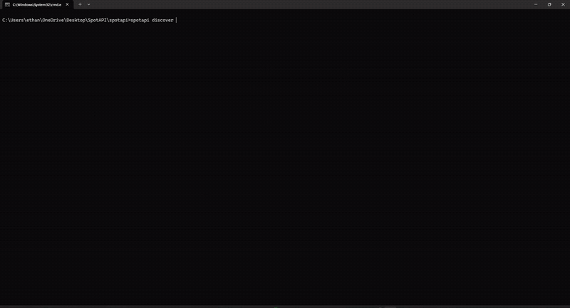
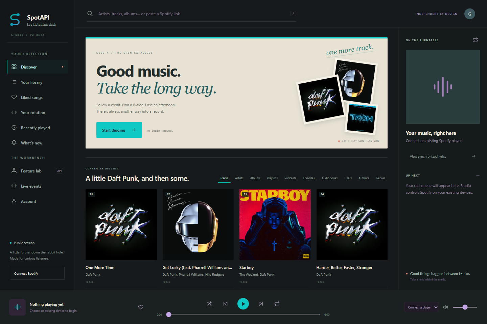

<p align="center">
  
</p>

<h1 align="center">SpotAPI</h1>
<p align="center"><b>Spotify for Python. Async, typed, and no API key for public data.</b></p>
<p align="center">
  <a href="#30-second-start">Start</a> ·
  <a href="#see-it-in-action">Demos</a> ·
  <a href="#studio">Studio</a> ·
  <a href="#build-it-into-your-app">Integrate</a> ·
  <a href="#guides">Guides</a>
</p>

<p align="center"><sub>Sponsored placements available · <a href="SPONSORSHIP.md">Sponsor SpotAPI</a></sub></p>

---

Search the Spotify catalogue from your terminal, or build a Python app on top of
fully typed async results. Start with public data, no signup and no developer
dashboard. Connect your account later for saved music, playlist editing and live
player events.

> **SpotAPI 2 is a breaking async release.** Synchronous projects can pin
> `spotapi==1.2.8`. See the [migration guide](MIGRATION.md) and the
> [release checks](docs/release-2.0.0.md).

## 30-second start

Requires Python 3.11 or newer.

```bash
python -m pip install spotapi
spotapi search "Daft Punk"
```



That's it. No key, no login, no config.

Prefer Python?

```python
import asyncio
from spotapi import Public


async def main() -> None:
    results = await Public.search("Daft Punk", limit=5)
    for track in results.tracks:
        print(track.name, track.uri)


asyncio.run(main())
```

`Public` searches ten categories, resolves Spotify links and streams tracks from
public playlists. It cleans up its own connections.

## Why SpotAPI

- **No API key for public data.** Search, lookups, credits, lyrics and playlists work anonymously.
- **Typed and async.** Every result is a model you can autocomplete, not a dict you have to guess at.
- **No surprises.** Reading a model never triggers a hidden HTTP request. Optional metadata stays optional.
- **Duplicate-aware playlists.** Edit one occurrence of a track without touching its twin.
- **Your account when you want it.** Liked songs, rankings, playlist edits and live player events.
- **A CLI that does real work.** Search, credits, playlists, library and player control from one command.
- **No developer dashboard setup.** No Client ID, no Premium requirement and no user cap for public data. [See the comparison](#spotapi-vs-the-official-web-api).

## SpotAPI vs the official Web API

In February 2026, Spotify [tightened Development Mode](https://developer.spotify.com/blog/2026-02-06-update-on-developer-access-and-platform-security)
for its official Web API. Libraries built on that API, such as Spotipy, work
within those limits. SpotAPI uses Spotify's web-player endpoints without a
developer app. These endpoints have their own rate limits, authentication
requirements and changing response contracts.

| | Official Web API (Development Mode) | SpotAPI, public data |
|---|---|---|
| Developer app / Client ID | Required, **one per developer** | Not needed |
| Spotify account | **Premium required** | Not needed |
| Authorized users | **Up to five** per Client ID | No cap to manage |
| Intended use | Non-commercial personal projects and learning | Your call, subject to the [legal notice](LEGAL_NOTICE.md) |
| Setup | Create an app, then wire up credentials | `pip install spotapi` |

Choose based on the endpoints and authentication your application needs.
SpotAPI relies on unofficial web-player contracts; see the
[verification boundaries](docs/release-2.0.0.md#boundaries) before integrating.

<sub>Based on Spotify's February 2026 announcement. The Premium requirement,
user cap and one-Client-ID limit apply to existing integrations too. Spotify
may change these rules again, so check the post for the latest.</sub>

## See it in action

Clone the repo and run any of these from its root. Install once:

```bash
python -m pip install -e ".[demo]"
```

| Demo | What you get | Run it |
|---|---|---|
| **[Discover](examples/discover.py)** ⭐ | A keyboard-driven terminal UI for browsing Spotify's public search. No login. **Start here.** | `python -m examples.discover "Daft Punk"` |
| **[Credit trail](examples/credit_trail.py)** | Connects *One More Time*, *Harder, Better, Faster, Stronger* and *Starboy* through shared contributor IDs, showing where one person is credited as producer, writer or lyricist. | `python -m examples.credit_trail` |
| **[Mix map](examples/mix_map.py)** | Finds harmonically compatible transitions in a public playlist and tells you how far to shift the incoming track's tempo. | `python -m examples.mix_map` |

Credit trail and Mix map accept your own Spotify links. Discover takes a search query.

## Studio

Open a track, read its credits, follow links into artists and albums, or expand
the typed data behind every view. Studio also shows public lyrics and can seek to
a timed line on a connected Spotify player.



```bash
python -m pip install -e ".[studio]"
python -m examples.studio
```

Use **Connect Spotify** to sign in through Spotify's normal login window, or set
`SPOTIFY_COOKIE` in a local `.env`. Cookies stay in Python. Playback controls an
existing Spotify device; Studio does not render audio.

[Studio guide](docs/studio.md) · [Small examples](examples)

## Go beyond search

The CLI also looks up credits, lists playlist occurrences, manages liked tracks
and controls an existing Spotify player:

```bash
spotapi search "Daft Punk" --type artist --json
spotapi get SPOTIFY_URL
spotapi credits 0DiWol3AO6WpXZgp0goxAV
spotapi playlist items PLAYLIST_ID --limit 10
spotapi library list
spotapi player status
```

`search` and `get` work anonymously. Library and player commands, playlist edits
and `playlist items --private` read `SPOTIFY_COOKIE` from your environment. See
[sign-in setup](docs/studio.md#sign-in).

Run `spotapi playlist --help`, `spotapi library --help` or `spotapi player --help`
for every action. Playlist `remove` and `move` take occurrence IDs from
`playlist items`, so duplicate tracks can be edited individually.

## Build it into your app

Pick the idea closest to yours:

| Your idea | Start with |
|---|---|
| A DJ crate with tempo and harmonic keys | [Playlist crate](examples/playlist_crate.py) |
| A credits rabbit hole | [Song credits](examples/credits.py) |
| A playlist discovery companion | `Public.get_radio()` · `Public.get_playlist_recommendations()` |
| Your own music dashboard | [Account, rankings and saved music](docs/account.md) |
| A duplicate-aware playlist curator | `Playlist.items()` · `Playlist.move_occurrences()` · `Playlist.remove_occurrences()` |
| A live now-playing display | [Player example](examples/player.py) · [Lyrics example](examples/lyrics.py) |

### Public data: reuse one `Catalogue`

For several operations, share a single context inside your async application:

```python
from spotapi import Catalogue

async with Catalogue() as spotify:
    results = await spotify.search("Daft Punk")
    artist = await spotify.get_artist(results.artists[0].uri)
```

### Your own account: `Private`

`Private` opens and closes the authenticated session for you:

```python
import os

from spotapi import Private

async with Private.from_cookies(os.environ["SPOTIFY_COOKIE"]) as spotify:
    favorites = await spotify.stats.get(time_range="medium_term", limit=5)
    for track in favorites.tracks:
        print(track.name)
```

### Production details

- Import result types from `spotapi.models`.
- Catch `SpotAPIError` for library failures.
- Use `AsyncClient` directly to share transports and configure connection options.
- See the guides for ownership, cancellation and explicit mutations.

## Guides

[Catalogue](docs/catalogue.md) · [Account](docs/account.md) · [Player](docs/player.md) ·
[Request policy](docs/transport.md) · [API layout](docs/api-layout.md) · [Migration from v1](MIGRATION.md)

## Sponsorship

Sponsor SpotAPI's maintenance and development. Monthly placements include a
labeled spot above Quickstart and, where relevant, a link in the guide your
customers would use. Category exclusivity is available by agreement.

Contact [aran.inbox.personal@gmail.com](mailto:aran.inbox.personal@gmail.com)
to discuss a placement and arrange payment directly through PayPal.
See [sponsorship details](SPONSORSHIP.md).

## Contributing

[Contributing](CONTRIBUTING.md) · [Tests](tests/README.md) · [Release review](docs/release-2.0.0.md) ·
[Legal notice](LEGAL_NOTICE.md) · [GPL-3.0](LICENSE)

If SpotAPI helps you build something, a ⭐ helps other developers find it.
