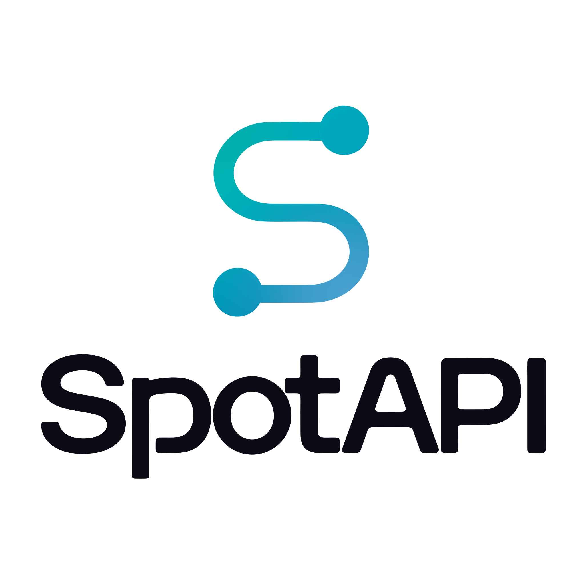
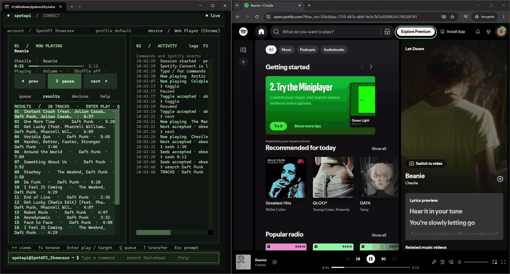
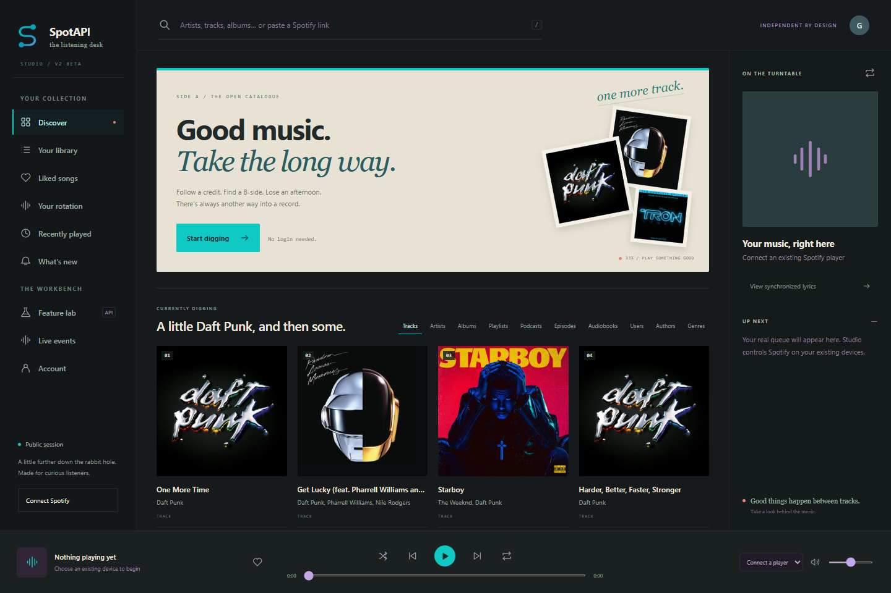

<p align="center">
  
</p>

<h1 align="center">SpotAPI</h1>

<p align="center">
  <strong>Spotify in your terminal. Spotify data in your Python app.</strong>
</p>

<p align="center">
  A typed, async Python library for Spotify's public catalogue, playlists, and connected players.<br>
  <strong>No developer app or API key for public data.</strong>
</p>

<p align="center">
  <a href="#get-started">Get started</a> ·
  <a href="#explore-in-the-terminal">Explore</a> ·
  <a href="#build-with-python">Python API</a> ·
  <a href="https://spotapi.readthedocs.io/">Documentation</a> ·
  <a href="SPONSORSHIP.md">Sponsor</a>
</p>

<p align="center">
  <strong>Language:</strong> English · <a href="README.pt-BR.md">Português (Brasil)</a> · <a href="README.es.md">Español</a> · <a href="README.fr.md">Français</a> · <a href="README.ja.md">日本語</a>
</p>

## Get started

Python 3.11+ is required. Start with a real search—no Spotify login, Client ID or configuration needed.

```bash
python -m pip install spotapi
python -m spotapi search "Daft Punk"
```



<p align="center"><sub>Connect · Search, navigate and control an existing Spotify player from your terminal. Spotify plays the audio; SpotAPI sends the controls.</sub></p>

That's the public catalogue. Search, resolve Spotify links, inspect credits and read public playlist metadata without setting up a Spotify developer application. The first request can take longer while SpotAPI discovers the current web-player queries; subsequent requests reuse the cached results.

**Building with Python instead?** The same installation provides a typed API. No terminal interface is required:

```python
import asyncio
from spotapi import Public

async def main():
    results = await Public.search("Daft Punk", limit=5)
    for track in results.tracks:
        print(track.name, track.uri)

asyncio.run(main())
```

[More Python examples](#build-with-python) · [Playlist audit and CSV export](examples/playlist_audit.py)

**Want something you can browse?** Open the interactive terminal explorer:

```bash
python -m pip install "spotapi[demo]"
python -m spotapi discover "Daft Punk"
```

Navigate search results, artwork and Spotify links without signing in. [Discover example](https://github.com/Aran404/SpotAPI/blob/main/examples/discover.py) · [Troubleshooting](https://spotapi.readthedocs.io/en/latest/troubleshooting/)

## Explore in the terminal

The CLI goes beyond search. Inspect an artist, pull track credits, or list a public playlist:

```bash
python -m spotapi search "Daft Punk" --type artist --json
python -m spotapi get SPOTIFY_URL
python -m spotapi playlist items PLAYLIST_ID --limit 10
```

These work without a developer API key. Account operations—liked music, private playlists and control of your existing Spotify player—require your own Spotify session. See the [account guide](https://spotapi.readthedocs.io/en/latest/account/) and [player guide](https://spotapi.readthedocs.io/en/latest/player/).

### Connect: control your Spotify player

Connect brings searching, device selection, up-next, playback and a live activity log into one keyboard-friendly terminal session. It operates an existing signed-in Spotify player; it does **not** stream, download or decrypt tracks.

Launch Connect with the optional terminal interface:

```bash
python -m pip install "spotapi[connect,browser]"
python -m playwright install chromium
python -m spotapi connect
```

First-time browser sign-in is covered by these commands. Already use `SPOTIFY_COOKIE` or a saved Connect profile? Install only `spotapi[connect]` and skip the browser download.

Use `search Daft Punk` to find music, `queue 1` to add a result, or `pause`, `next`, and `seek 1:30` to control playback. Open `/devices` to browse available players; `/use 2` selects one without transferring playback, while `/transfer 2` transfers playback. `Ctrl+P` opens the command palette.

Connect requires your Spotify session for player controls. For browser-based sign-in, you may also need the `browser` extra and Playwright's Chromium installation; see the [Connect guide](docs/connect.md) for setup.

## See what else it can do

SpotAPI also powers **Studio**, a desktop music explorer built on the same library. Open tracks, inspect credits, follow artists and albums, and display timed lyrics. With a connected Spotify player, clicking a lyric can seek playback to that line.



[Watch the synchronized-lyrics demo (GIF, about 11 MB)](assets/lyrics-sync-demo.gif) · Studio itself does not stream full Spotify tracks.

```bash
python -m pip install "spotapi[studio]"
python -m spotapi studio
```

Studio uses a native WebView. [Studio setup](https://spotapi.readthedocs.io/en/latest/studio/) explains platform requirements and Spotify sign-in. Lyric availability depends on the source and account entitlements; seeking needs an authenticated, controllable player.

## Build with Python

The terminal demos are examples. **SpotAPI is a Python library first:** async operations, typed results, explicit network calls and reusable sessions.

```python
import asyncio
from spotapi import Public


async def main() -> None:
    results = await Public.search("Daft Punk", limit=5)
    for track in results.tracks:
        print(track.name, track.uri)


asyncio.run(main())
```

For several related operations, reuse one catalogue session:

```python
import asyncio
from spotapi import Catalogue


async def main() -> None:
    async with Catalogue() as spotify:
        results = await spotify.search("Daft Punk")
        if results.artists:
            artist = await spotify.get_artist(results.artists[0].uri)
            print(artist.name)


asyncio.run(main())
```

**Working with large playlists?** [Audit up to 10,000 playlist occurrences](examples/playlist_audit.py), identify duplicate tracks and unavailable entries, and export a CSV. The example pages through results instead of loading the whole playlist into memory. Run it from a repository checkout.

### Where to go next

| Build | Start here |
|---|---|
| Music search or public metadata tools | [Public catalogue](https://spotapi.readthedocs.io/en/latest/catalogue/) |
| A playlist organizer that handles duplicate tracks correctly | [Playlist API](https://spotapi.readthedocs.io/en/latest/account/) |
| A live now-playing display or controller | [Player example](https://github.com/Aran404/SpotAPI/blob/main/examples/player.py) |
| A personal music dashboard | [Account and statistics](https://spotapi.readthedocs.io/en/latest/account/) |
| A DJ crate using tempo and harmonic keys | [Playlist crate](https://github.com/Aran404/SpotAPI/blob/main/examples/playlist_crate.py) |
| An experimental local music recommender | [Taste Lab](https://github.com/Aran404/SpotAPI/blob/main/examples/taste_lab/README.md) |

## Why SpotAPI?

- **Start without credentials.** Public catalogue search and metadata require no Spotify developer app.
- **Typed, async results.** Work with Python models instead of guessing dictionary keys.
- **Explicit I/O.** Reading a model doesn't silently trigger another HTTP request.
- **More than read-only metadata.** With your authenticated session, manage saved music, edit playlist occurrences and control existing players.
- **Designed for exploration.** Use the CLI, Discover and Studio to understand capabilities before integrating them into code.

SpotAPI uses unofficial Spotify web-player endpoints, so behavior can change when Spotify changes those endpoints. It is **not** a substitute for the official Web API in every use case, and public-data access is different from authenticated playback access. [Compare the APIs](https://spotapi.readthedocs.io/en/latest/from-spotipy/) · [Verification boundaries](https://spotapi.readthedocs.io/en/latest/release-checks/#boundaries)

## Documentation and migration

[Quickstart](https://spotapi.readthedocs.io/en/latest/quickstart/) · [API reference](https://spotapi.readthedocs.io/en/latest/reference/) · [Coming from Spotipy](https://spotapi.readthedocs.io/en/latest/from-spotipy/) · [CLI and discovery](https://spotapi.readthedocs.io/en/latest/discovery/) · [Troubleshooting](https://spotapi.readthedocs.io/en/latest/troubleshooting/)

**Upgrading from v1?** SpotAPI 2 is async-first and contains breaking changes. Existing v1 apps can pin `spotapi==1.2.8` while migrating, or use `SyncCatalogue` for new synchronous scripts. Read the [migration guide](MIGRATION.md).

## Support SpotAPI

SpotAPI is free and open source. Sponsorship helps fund maintenance, testing and documentation without changing the library's behavior or adding paywalls.

**Build developer tools?** [Explore sponsorship options](SPONSORSHIP.md) to reach developers using SpotAPI. Paid placements are clearly labeled and help support the project.

<!-- Active, clearly labeled sponsor placements go below this line. Keep them compact and below the product demos. -->

## Contributing

Bug reports, reproducible issues and thoughtful contributions are welcome. [Contributing](CONTRIBUTING.md) · [Tests](tests/README.md) · [Legal notice](LEGAL_NOTICE.md) · [GPL-3.0](LICENSE)

If SpotAPI helps you build something, **[star the repository](https://github.com/Aran404/SpotAPI)** to help other developers discover it.
