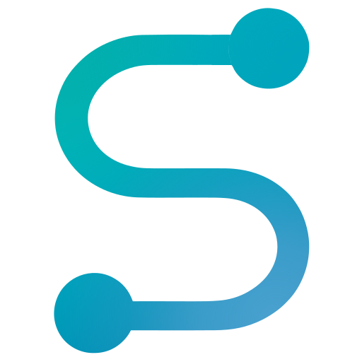
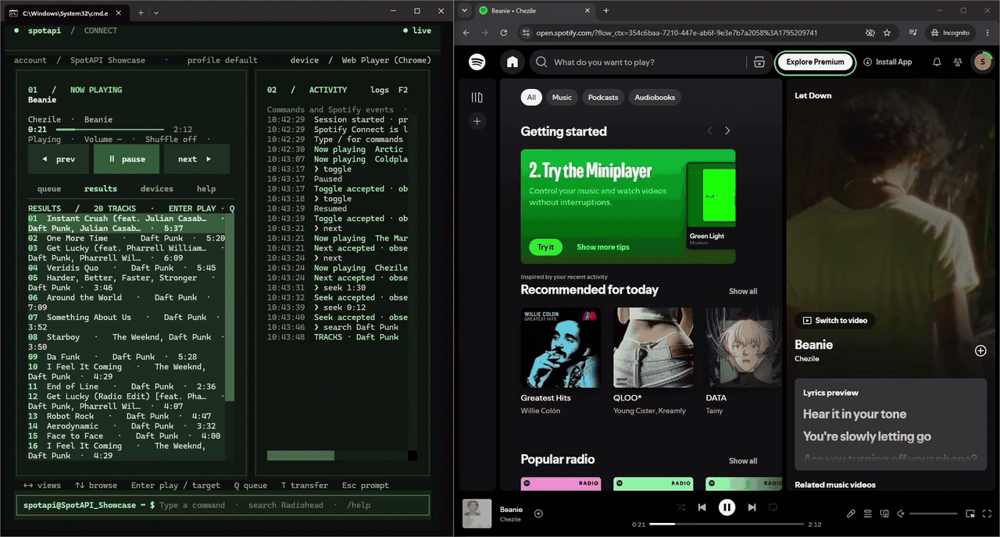
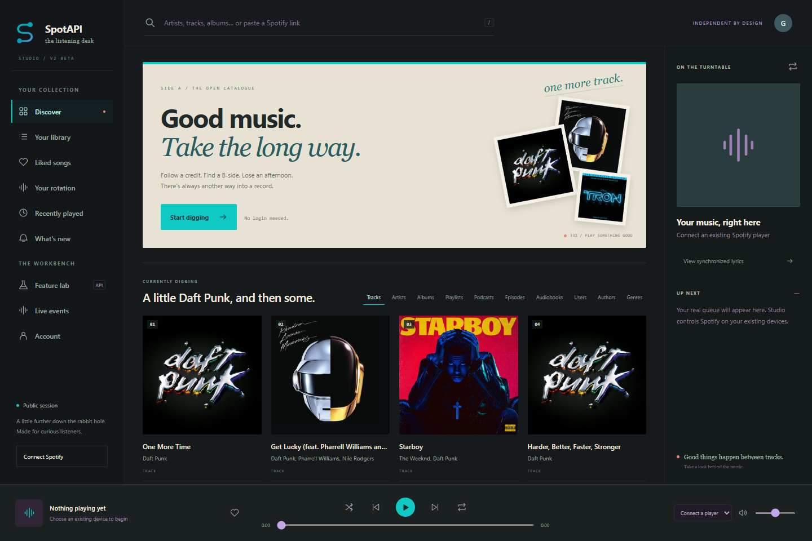

<p align="center">
  
</p>

<h1 align="center">SpotAPI</h1>

<p align="center">
  <strong>Crie aplicativos do Spotify em Python com uma API tipada e assíncrona.</strong>
</p>

<p align="center">
  Use o SpotAPI para o catálogo público, playlists e players conectados do Spotify.<br>
  <strong>Sem aplicativo de desenvolvedor nem chave de API para dados públicos.</strong>
</p>

<p align="center">
  <a href="#comece-agora">Comece agora</a> ·
  <a href="#explore-pelo-terminal">Explore</a> ·
  <a href="#desenvolva-com-python">API Python</a> ·
  <a href="https://spotapi.readthedocs.io/">Documentação</a> ·
  <a href="SPONSORSHIP.md">Patrocine</a>
</p>

<p align="center">
  <a href="https://discord.gg/vcFvvTuQzn"></a>
</p>

<p align="center">
  <strong>Idioma:</strong> <a href="README.md">English</a> · Português (Brasil) · <a href="README.es.md">Español</a> · <a href="README.fr.md">Français</a> · <a href="README.ja.md">日本語</a>
</p>

## Comece agora

É necessário Python 3.11 ou superior. Comece com uma busca real, sem precisar de login do Spotify, Client ID ou configuração.

```bash
python -m pip install spotapi
python -m spotapi search "Daft Punk"
```

Use a mesma API em Python:

```python
import asyncio
from spotapi import Public

async def main():
    results = await Public.search("Daft Punk", limit=5)
    for track in results.tracks:
        print(track.name, track.uri)

asyncio.run(main())
```

[Mais exemplos em Python](#desenvolva-com-python) · [Auditoria de playlists e exportação CSV](examples/playlist_audit.py) · [Guia de Python sem chave de API](docs/no-api-key.md)

A primeira requisição pode demorar mais enquanto o SpotAPI descobre e armazena em cache as consultas atuais do web player.

Experimente o explorador interativo no terminal:

```bash
python -m pip install "spotapi[demo]"
python -m spotapi discover "Daft Punk"
```

Navegue pelos resultados de busca, capas e links do Spotify sem fazer login. [Exemplo do Discover](https://github.com/Aran404/SpotAPI/blob/main/examples/discover.py) · [Solução de problemas](https://spotapi.readthedocs.io/en/latest/troubleshooting/)

## Explore pelo terminal

A CLI vai além da busca. Consulte um artista, obtenha os créditos de uma faixa ou liste uma playlist pública:

```bash
python -m spotapi search "Daft Punk" --type artist --json
python -m spotapi get SPOTIFY_URL
python -m spotapi playlist items PLAYLIST_ID --limit 10
```

Esses comandos funcionam sem chave de API de desenvolvedor. Operações de conta — músicas curtidas, playlists privadas e controle do seu player existente do Spotify — exigem sua própria sessão do Spotify. Consulte o [guia de conta](https://spotapi.readthedocs.io/en/latest/account/) e o [guia do player](https://spotapi.readthedocs.io/en/latest/player/).

### Connect: controle seu player do Spotify

O Connect reúne busca, seleção de dispositivo, fila de próximas músicas, reprodução e registro de atividades em tempo real numa sessão de terminal fácil de usar pelo teclado. Ele controla um player existente com login no Spotify; **não** transmite, baixa nem descriptografa faixas.



<p align="center"><sub>Connect · Pesquise, navegue e controle um player existente do Spotify pelo terminal. O Spotify reproduz o áudio; o SpotAPI envia os comandos.</sub></p>

Inicie o Connect:

```bash
python -m pip install "spotapi[connect,browser]"
python -m playwright install chromium
python -m spotapi connect
```

Esses comandos incluem o primeiro login pelo navegador. Já usa `SPOTIFY_COOKIE` ou tem um perfil salvo no Connect? Instale apenas `spotapi[connect]` e pule o download do navegador.

Use `search Daft Punk`, `queue 1`, `pause`, `next` ou `seek 1:30`. `Ctrl+P` abre a paleta de comandos. Consulte o [guia do Connect](docs/connect.md) para selecionar dispositivos e configurar.

## Veja o que mais ele faz

O SpotAPI também alimenta o **Studio**, um explorador de música para desktop construído com a mesma biblioteca. Abra faixas, consulte créditos, siga artistas e álbuns e exiba letras sincronizadas. Com um player do Spotify conectado, clicar numa linha da letra pode avançar a reprodução até aquele trecho.



[Assista à demonstração de letras sincronizadas (GIF, cerca de 11 MB)](assets/lyrics-sync-demo.gif) · O próprio Studio não transmite músicas completas do Spotify.

```bash
python -m pip install "spotapi[studio]"
python -m spotapi studio
```

O Studio usa uma WebView nativa. A [configuração do Studio](https://spotapi.readthedocs.io/en/latest/studio/) explica os requisitos da plataforma e o login no Spotify. A disponibilidade das letras depende da fonte e dos direitos da conta; avançar para um trecho exige um player autenticado que aceite o comando.

## Apoie o SpotAPI

Os patrocinadores ajudam a manter o SpotAPI gratuito e financiam manutenção, testes e documentação. [Torne-se um patrocinador](SPONSORSHIP.md).

<details open>
<summary><strong>Patrocinadores</strong></summary>

<!-- Each sponsor gets a separate table. Add new cards before the closing details tag. -->

<table>
  <tr>
    <td width="100%">
      <p align="center"><a href="https://www.rapidproxy.io/?code=Z89BQULDV"></a></p>
      <p>Proxies residenciais confiáveis para automação em Python e coleta de dados da web. Mais de 90 milhões de IPs, segmentação global, sessões rotativas e persistentes e suporte a HTTP(S)/SOCKS5.</p>
      <sub>Patrocínio pago · Link de afiliado. O SpotAPI pode receber uma comissão pelas compras.</sub>
    </td>
  </tr>
</table>

</details>

## Desenvolva com Python

Reutilize uma sessão do catálogo para operações relacionadas:

```python
import asyncio
from spotapi import Catalogue


async def main() -> None:
    async with Catalogue() as spotify:
        results = await spotify.search("Daft Punk")
        if results.artists:
            artist = await spotify.get_artist(results.artists[0].uri)
            print(artist.name)


asyncio.run(main())
```

**Trabalhando com playlists grandes?** [Audite até 10.000 ocorrências de uma playlist](examples/playlist_audit.py), identifique faixas duplicadas e entradas indisponíveis e exporte um CSV. O exemplo percorre os resultados por páginas em vez de carregar toda a playlist na memória. Execute a partir de um checkout do repositório.

### Próximos passos

| O que desenvolver | Comece aqui |
|---|---|
| Ferramentas de busca musical ou metadados públicos | [Catálogo público](https://spotapi.readthedocs.io/en/latest/catalogue/) |
| Organizador de playlists que lida corretamente com faixas duplicadas | [API de playlists](https://spotapi.readthedocs.io/en/latest/account/) |
| Visor ou controlador em tempo real da música atual | [Exemplo do player](https://github.com/Aran404/SpotAPI/blob/main/examples/player.py) |
| Painel pessoal de músicas | [Conta e estatísticas](https://spotapi.readthedocs.io/en/latest/account/) |
| Coleção de DJ baseada em BPM e tonalidades harmônicas | [Coleção de playlist](https://github.com/Aran404/SpotAPI/blob/main/examples/playlist_crate.py) |
| Recomendador experimental e local de músicas | [Taste Lab](https://github.com/Aran404/SpotAPI/blob/main/examples/taste_lab/README.md) |

## Por que SpotAPI?

- **Comece sem credenciais.** Buscar e consultar metadados do catálogo público não exige aplicativo de desenvolvedor do Spotify.
- **Resultados tipados e assíncronos.** Trabalhe com modelos Python em vez de adivinhar chaves de dicionários.
- **E/S explícita.** Ler um modelo não dispara outra requisição HTTP silenciosamente.
- **Mais que metadados somente de leitura.** Com uma sessão autenticada, gerencie músicas salvas, edite ocorrências em playlists e controle players existentes.
- **Feito para explorar.** Use a CLI, o Discover e o Studio para conhecer os recursos antes de integrá-los ao código.

O SpotAPI usa endpoints não oficiais do web player do Spotify; portanto, seu comportamento pode mudar quando o Spotify altera esses endpoints. Ele **não** substitui a Web API oficial em todos os casos, e o acesso a dados públicos é diferente do acesso autenticado à reprodução. [Compare as APIs](https://spotapi.readthedocs.io/en/latest/from-spotipy/) · [Limites de verificação](https://spotapi.readthedocs.io/en/latest/release-checks/#boundaries)

## Documentação e migração

[Introdução rápida](https://spotapi.readthedocs.io/en/latest/quickstart/) · [Referência da API](https://spotapi.readthedocs.io/en/latest/reference/) · [Migrando do Spotipy](https://spotapi.readthedocs.io/en/latest/from-spotipy/) · [CLI e descoberta](https://spotapi.readthedocs.io/en/latest/discovery/) · [Solução de problemas](https://spotapi.readthedocs.io/en/latest/troubleshooting/)

**Atualizando da v1?** O SpotAPI 2 prioriza operações assíncronas e tem mudanças incompatíveis. Aplicativos existentes da v1 podem fixar `spotapi==1.2.8` durante a migração, ou usar `SyncCatalogue` em novos scripts síncronos. Leia o [guia de migração](MIGRATION.md).

## Como contribuir

Relatos de bugs, problemas reproduzíveis e contribuições bem pensadas são bem-vindos. [Como contribuir](CONTRIBUTING.md) · [Testes](tests/README.md) · [Aviso legal](LEGAL_NOTICE.md) · [GPL-3.0](LICENSE)

Se o SpotAPI ajudar você a criar algo, **[dê uma estrela ao repositório](https://github.com/Aran404/SpotAPI)** para que outros programadores também o descubram.
